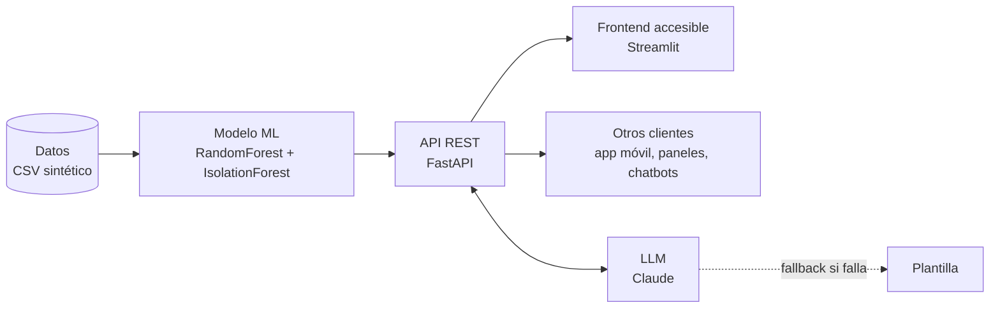

# Aire Madrid — plantilla Smart City (FastAPI + Streamlit + ML + LLM)

Predicción de calidad del aire por distrito y hora, detección de anomalías y explicación en lenguaje natural accesible.

## Arranque (3 terminales o 2 si ya tienes el CSV)
```bash
python -m venv .venv && source .venv/bin/activate   # Windows: .venv\Scripts\activate
pip install -r requirements.txt
python data/generate.py                      # crea data/sample.csv
uvicorn app.main:app --reload                # API -> http://localhost:8000/docs
streamlit run frontend/streamlit_app.py      # (otra terminal) UI -> http://localhost:8501
```
Opcional: copia `.env.example` a `.env` y pon tu `ANTHROPIC_API_KEY`. Sin clave funciona igual (explicaciones por plantilla).

## Arquitectura

- `data/generate.py` — genera el CSV sintético (`data/sample.csv`).
- `app/model.py` — predicción (RandomForest), anomalías (IsolationForest) e importancia de variables.
- `app/llm.py` — explicación en lenguaje natural; sin clave, sin red o con error → plantilla.
- `app/main.py` — API REST: `/health`, `/predict`, `/anomalies`, `/stats` (docs en `/docs`).
- `frontend/streamlit_app.py` — interfaz accesible + pestaña "Sobre el proyecto".

## Tests
```bash
.venv/bin/python -m pytest -q     # tests de API (TestClient, sin red)
./scripts/smoke.sh                # punta a punta: API real + Streamlit
```
`tests/test_api.py` cubre: `/health` OK; `/predict` devuelve valor > 0 y nivel válido; coherencia del modelo (más tráfico → más NO₂); fallback del LLM sin API key; validación de entradas (hora inválida → 422, distrito inexistente → 404); `/anomalies` devuelve una lista.

## Accesibilidad
Lectura fácil, texto grande, alto contraste, modo oscuro, español/inglés, lectura en voz alta y descripción textual de los gráficos.
