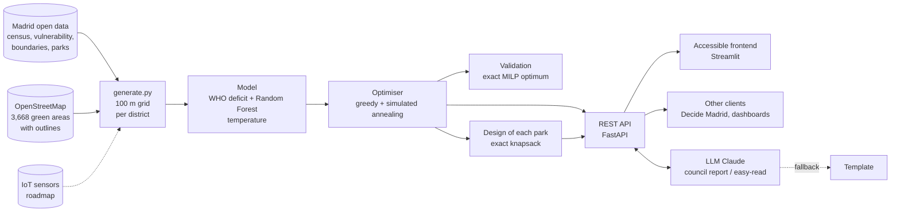

# 🌳 Pocket Parks Madrid — where to invest every euro to bring green space to those who need it most

🇬🇧 **English** · 🇪🇸 [Español](README.es.md)

> A decision engine for city officials: it **detects** neighbourhoods lacking green space, **decides where** to build each
> pocket park and **what to build** in it, and **justifies** the investment to the city council. Real open data from
> Madrid, optimisation validated against the exact optimum, and generative AI.

- **Author:** [villanuevadrian](https://github.com/villanuevadrian), representing **Universidad Carlos III de Madrid (UC3M)**
- **Programme:** **Líderes Digitales Universitarios** (University Digital Leaders, Cátedras Telefónica), in two stages:
  1. **2-hour technical challenge at 42 Madrid**: design and build a solution to an urban challenge.
  2. **Debate at Madrid City Council** on competitive smart cities: with AI vs. without AI.
- **Challenge #42 · Health and Urban Wellbeing:** *"Design an app that detects neighbourhoods with a green-space deficit and
  proposes micro-interventions (pocket parks)."*


## Key results
- **Tetuán district, €500,000:** the share of older people and children with a green space within 300 m (WHO criterion)
  rises from **57% to 82%**, within parking, maintenance and equity constraints.
- **Validated:** the metaheuristic reaches **98.8–100% of the exact optimum** (integer linear programming) and is
  **2.7–9× better** than placing parks at random.
- **Scale:** works for all **21 districts** and ranks the **131 neighbourhoods** of Madrid using official data.

## What it does: three chained decisions
| # | Decision | How |
|---|---|---|
| 1 | **Which neighbourhoods** lack green space | Real green area per neighbourhood (OpenStreetMap) + official vulnerability ranking; per-district map with the WHO criterion (≥0.5 ha within 300 m) |
| 2 | **Where** to build each pocket park | Budget-constrained maximum coverage: greedy + simulated annealing, validated against the exact optimum (HiGHS) |
| 3 | **What to build** in each one | Exact knapsack over 8 micro-interventions (shade trees, benches, playground, fountain, rain garden…) based on who lives nearby |

Also: budget scenario curve (diminishing returns), downloadable **council report** (HTML, printable to PDF) and texts
written by **generative AI** (Claude) with a template fallback, so the service never goes down.

| City: detection | Optimiser | Proposed portfolio | What to build |
|---|---|---|---|
|  |  |  |  |

- **User:** municipal officer (district board / environment department). Residents get the same proposal in easy-to-read language.
- **Accessibility:** easy-read mode, large text, high contrast, dark mode, ES/EN (beta), text-to-speech, text descriptions
  of every map and chart, and statuses shown with icon **and** text.
- **Business model:** B2G SaaS for city councils; IoT sensors to measure real impact after construction and recalibrate the model.

> The app interface is in Spanish (English beta), as it was built for Madrid City Council.

## Architecture

| Module | What it does |
|---|---|
| `data/generate.py` | Reads official data (`data/raw/`) and OpenStreetMap; builds the neighbourhood ranking and each district's grid |
| `app/model.py` | Deficit, Random Forest temperature model, optimiser, MILP validation and park design |
| `app/llm.py` | Council report and easy-read text with Claude; no key or an error → template |
| `app/main.py` | REST API: `/ciudad`, `/barrios`, `/diagnostico`, `/optimizar`, `/escenarios`, `/validacion`, `/parque/{id}` |
| `frontend/streamlit_app.py` | Tool (City, Diagnosis, Optimiser, Detail) and an "About the project" section |

## Getting started
```bash
python3.12 -m venv .venv && source .venv/bin/activate
pip install -r requirements.lock.txt           # exact tested versions
uvicorn app.main:app --reload                  # API -> http://localhost:8000/docs
streamlit run frontend/streamlit_app.py        # (another terminal) app -> http://localhost:8501
```
Processed data is included in the repository; `python data/generate.py` rebuilds it from `data/raw/`.
Optional: copy `.env.example` to `.env` and add your `ANTHROPIC_API_KEY` so Claude writes the texts.
Without a key it works the same (template texts).

## Data and attribution
| Source | Use | Licence / attribution |
|---|---|---|
| [Madrid City Council — datos.madrid.es](https://datos.madrid.es): population per neighbourhood (1 Jan 2026), vulnerability ranking (2020), green area per district (2025), main parks and gardens, neighbourhood boundaries | Census, equity, official green area, geometry | Reuse with source citation: *Ayuntamiento de Madrid* |
| [OpenStreetMap](https://www.openstreetmap.org/copyright) (`leisure=park\|garden`, via Overpass) | Outline and area of 3,668 green spaces | © OpenStreetMap contributors, [ODbL](https://opendatacommons.org/licenses/odbl/) |
| Calibrated synthetic data | Population distribution within each neighbourhood, ages, temperature, candidate sites and costs | Generated in `data/generate.py` |

## Methodology (how each number is computed)
| Calculation | Formula | Rationale / source |
|---|---|---|
| **Green access (main KPI)** | % of older people (≥65) and children (<12) whose cell is ≤300 m in a straight line from a green space of ≥0.5 ha | **WHO Europe** indicator (*Urban green spaces: a brief for action*, 2017): 0.5–1 ha of green within 300 m |
| **Distance to green** | straight-line distance from the cell centre to the nearest **real edge** of a ≥0.5 ha green space (edge sampled every 20 m; 0 if the cell is inside) | OpenStreetMap outlines. The 203 municipal parks without outlines: centre + 150 m (park) / 50 m (garden) radius |
| **Green per inhabitant** | m² of green ÷ census population | District: official council figure. Neighbourhood: sum of OSM areas inside the official boundary |
| **Neighbourhood priority** | 0.6 × vulnerability + 0.4 × green deficit (1 − min(m²/inhab, 15)/15) | Vulnerability: official council ranking. 15 m²/inhab: upper end of common recommendations (9–15). Weights: editable assumption |
| **Cell deficit index** | 0.45 × remoteness (dist/600 m) + 0.30 × heat (normalised) + 0.25 × vulnerability | Weighs proximity (WHO criterion) above heat and equity. Weights: editable assumption |
| **Temperature reduction** | Random Forest (green, asphalt, density → °C) predicts before/after adding the park in cells within 150 m | Surrogate model; mean error ±0.5 °C on validation. Synthetic temperature data → recalibrate with satellite data |
| **Optimisation** | max Σ weights × (new vulnerable residents within 300 m + equity + people cooled) subject to budget ≤ B; each other constraint applies a 30% penalty | Budgeted maximum coverage problem (NP-hard): benefit/cost greedy + simulated annealing (1,500 iterations) |
| **Validation** | exact optimum via integer linear programming (HiGHS): max Σ w·y, y_j ≤ Σ x_i covering j, Σ cost·x ≤ budget | Simulated annealing reaches 98.8–100% of the optimum in the districts tested; 2.7–9× better than random portfolios |
| **What to build** | per park, exact knapsack over 8 elements (2⁸ = 256 combinations): max Σ utility s.t. m² ≤ 85% of the site and cost ≤ 35% of the park budget; utility = Σ weight × benefit (older people, children, heat, water) | Weights = real share of older people and children within 300 m and the area's heat index; water has a fixed weight of 0.3. Footprint, cost and benefit of each element: order-of-magnitude assumptions |
| **Cost per resident** | park cost ÷ residents who gain green space within 300 m | Construction cost €150–320/m² and maintenance €3–6/m²·year: order-of-magnitude assumptions |

## Limitations
- **Candidate sites, costs and temperature are synthetic** (proof of concept). In production: municipal land inventory,
  cadastre and satellite land-surface temperature (Landsat/Sentinel).
- **OpenStreetMap is crowdsourced**: some areas may be missing or extra; unnamed gardens are discarded (usually private courtyards).
- Municipal parks have no outline (approximate radius). **Straight-line distances**, not walking distances.
- Vulnerability ranking from **2020** (latest published). In districts with no vulnerable neighbourhoods the equity constraint does not apply.
- AI-generated texts may contain errors: their source is shown and they should be reviewed before being presented.

## Tests
```bash
python -m pytest -q          # 26 tests: API, calculation audit and validation against the exact optimum (offline)
./scripts/smoke.sh           # end to end: real API + Streamlit
```
Includes **audit** tests that independently recompute that every cell falls within its official neighbourhood, that
population matches the census and that the optimiser's coverage is correct.

## How it was built
The core was built during the 2-hour challenge at 42 Madrid, then extended and audited for publication (OpenStreetMap
outlines, validation against the exact optimum, park design, council report). Developed with **Claude Code** as a coding
assistant, following a lightweight software engineering workflow:
1. **Plan before code**, approving each decision (challenge, user, success and constraint metrics).
2. **Small steps with tests** after every change (`pytest` + `scripts/smoke.sh`) and one commit per step.
3. **Independent reviewer agent** (`.claude/agents/jurado.md`) that scores the app against the jury's rubric without having
   seen the development; its top-priority improvements were applied.
4. **Calculation audit**: every number is recomputed independently and the optimiser is validated against the exact optimum.

`CLAUDE.md` holds the working rules and `PROMPT_ARRANQUE.md` the preparation prompt (both in Spanish).

## Licence
Code under the [MIT](LICENSE) licence. Data keeps its original licence (see *Data and attribution*).
