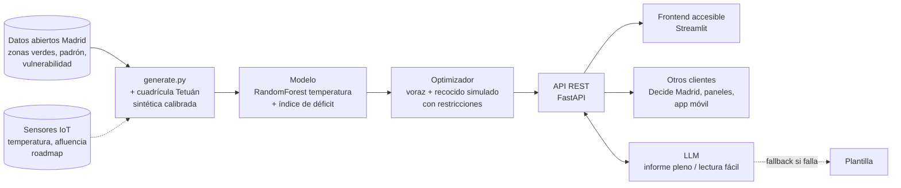

# Parques bolsillo — motor de decisión para acercar el verde a quien más lo necesita

Reto #42 (Salud y Bienestar Urbano): detectar barrios con déficit de zonas verdes y proponer micro-intervenciones.
**Usuario:** técnico del Ayuntamiento de Madrid que debe decidir y justificar ante el pleno dónde invertir.
**Caso:** distrito de Tetuán (3,7 m² de verde/hab y alta vulnerabilidad), presupuesto de 500.000 €.

## Arranque (2 terminales)
```bash
source .venv/bin/activate
python data/generate.py                      # prepara datos reales + sintéticos calibrados
uvicorn app.main:app --reload                # API -> http://localhost:8000/docs
streamlit run frontend/streamlit_app.py      # (otra terminal) UI -> http://localhost:8501
```
Instalación limpia: `python -m venv .venv && .venv/bin/pip install -r requirements.lock.txt` (versiones exactas probadas).
Opcional: copia `.env.example` a `.env` y pon tu `ANTHROPIC_API_KEY`. Sin clave funciona igual (textos por plantilla).

## Arquitectura

- `data/generate.py` — lee los CSV oficiales de `data/raw/` y genera `distritos.csv` y `barrios.csv` (reales: ranking de los 131 barrios), `celdas.csv` y `candidatos.csv` (sintéticos calibrados).
- `app/model.py` — Random Forest de temperatura (modelo sustituto), índice de déficit, evaluación de KPIs y restricciones, optimizador voraz + recocido simulado.
- `app/llm.py` — informe para el pleno y ficha en lectura fácil; sin clave, sin red o con error → plantilla.
- `app/main.py` — API REST: `/health`, `/ciudad`, `/barrios`, `/diagnostico`, `/optimizar`, `/parque/{id}` (docs en `/docs`).
- `frontend/streamlit_app.py` — 5 pantallas: Ciudad, Diagnóstico, Optimizador, Detalle del parque, Sobre el proyecto.

## Datos
| Fuente | Tipo | Uso |
|---|---|---|
| [Superficie de zonas verdes por distrito 2025](https://datos.madrid.es/dataset/300266-0-arbolado-superficie) | Real | m² de verde por distrito |
| [Población por distrito y barrio, 1-ene-2026](https://datos.madrid.es/dataset/300557-0-poblacion-distrito-barrio) | Real | m²/hab y población de cada barrio de Tetuán |
| [Ranking de vulnerabilidad 2020](https://datos.madrid.es/dataset/300301-0-ranking-vulnerabilidad) | Real | Prioridad por equidad |
| Ranking de prioridad de los 131 barrios | Real (cálculo propio) | 60 % vulnerabilidad del barrio + 40 % déficit verde del distrito |
| Cuadrícula de 100 m de Tetuán, temperatura, solares candidatos | Sintético calibrado | Optimización (la población suma el padrón real) |

## Métricas
- **Éxito:** % de mayores y niños con verde a <300 m (OMS Europa), m²/hab, °C de reducción, coste por vecino.
- **Restricción:** presupuesto (dura), plazas de aparcamiento, mantenimiento anual, % de inversión en barrios vulnerables.

## Tests
```bash
.venv/bin/python -m pytest -q     # tests de API (TestClient, sin red)
./scripts/smoke.sh                # punta a punta: API real + Streamlit
```
`tests/test_api.py` cubre: salud de la API; los 21 distritos reales; detección de los 131 barrios; población calibrada con el padrón; el optimizador
respeta el presupuesto, mejora los KPIs y el recocido nunca empeora al voraz; más presupuesto no empeora; los parques
enfrían; fallback del LLM sin API key; detalle en lectura fácil; validación de entradas (422/404).

## Detección a tres escalas
Distrito para priorizar → **barrio para detectar el déficit** (131 barrios reales) → manzana de 100 m para decidir dónde intervenir.

## Accesibilidad
Lectura fácil, texto grande, alto contraste, modo oscuro, español/inglés, lectura en voz alta y descripción textual de mapas y gráficos.
