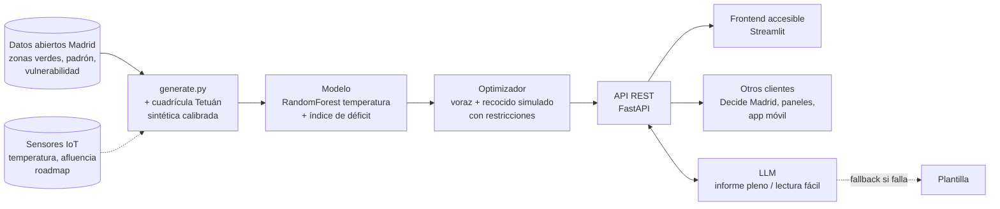

# Parques bolsillo — motor de decisión para acercar el verde a quien más lo necesita

Reto #42 (Salud y Bienestar Urbano): detectar barrios con déficit de zonas verdes y proponer micro-intervenciones.
**Usuario:** técnico del Ayuntamiento de Madrid que debe decidir y justificar ante el pleno dónde invertir.
**Caso:** los **21 distritos de Madrid**, cada uno con su mapa (selector de distrito). Demo principal: Tetuán (3,7 m² de verde/hab y alta vulnerabilidad), presupuesto de 500.000 €.

## Arranque (2 terminales)
```bash
source .venv/bin/activate
python data/generate.py                      # prepara datos reales + sintéticos calibrados
uvicorn app.main:app --reload                # API -> http://localhost:8000/docs
streamlit run frontend/streamlit_app.py      # (otra terminal) UI -> http://localhost:8501
```
Instalación limpia: `python -m venv .venv && .venv/bin/pip install -r requirements.lock.txt` (versiones exactas probadas).
Opcional: copia `.env.example` a `.env` y pon tu `ANTHROPIC_API_KEY`. Sin clave funciona igual (textos por plantilla).

## Arquitectura

- `data/generate.py` — lee los CSV oficiales de `data/raw/` y genera `distritos.csv` y `barrios.csv` (reales: ranking de los 131 barrios), `celdas.csv` y `candidatos.csv` (sintéticos calibrados).
- `app/model.py` — Random Forest de temperatura (modelo sustituto), índice de déficit, evaluación de KPIs y restricciones, optimizador voraz + recocido simulado.
- `app/llm.py` — informe para el pleno y ficha en lectura fácil; sin clave, sin red o con error → plantilla.
- `app/main.py` — API REST: `/health`, `/ciudad`, `/barrios`, `/diagnostico?distrito=`, `/optimizar`, `/parque/{id}?distrito=` (docs en `/docs`). Un modelo por distrito, cargado bajo demanda y en caché.
- `frontend/streamlit_app.py` — 5 pantallas: Ciudad, Diagnóstico, Optimizador, Detalle del parque, Sobre el proyecto.

## Datos
| Fuente | Tipo | Uso |
|---|---|---|
| [Superficie de zonas verdes por distrito 2025](https://datos.madrid.es/dataset/300266-0-arbolado-superficie) | Real | m² de verde por distrito |
| [Población por distrito y barrio, 1-ene-2026](https://datos.madrid.es/dataset/300557-0-poblacion-distrito-barrio) | Real | m²/hab y población de cada barrio de Tetuán |
| [Ranking de vulnerabilidad 2020](https://datos.madrid.es/dataset/300301-0-ranking-vulnerabilidad) | Real | Prioridad por equidad |
| Zonas verdes de [OpenStreetMap](https://www.openstreetmap.org) (Overpass, `leisure=park|garden`): 3.668 con contorno, 2.202 de tamaño bolsillo | Real (colaborativo) | Superficie verde **por barrio**, parques bolsillo existentes y distancias |
| Ranking de prioridad de los 131 barrios | Real (cálculo propio) | 60 % vulnerabilidad del barrio + 40 % déficit de verde del barrio |
| [Límites oficiales de barrios](https://datos.madrid.es/dataset/900012-0-limites-administrativos-mapas) (TopoJSON) | Real | Silueta de Tetuán, barrio de cada celda y anillo de 300 m |
| [Principales parques y jardines municipales](https://datos.madrid.es/dataset/200761-0-parques-jardines) (203 con coordenadas) | Real (radio aproximado) | Distancia real al verde, sin fronteras administrativas |
| Cuadrícula de 100 m de cada distrito, temperatura, solares candidatos | Sintético calibrado | Optimización (la población suma el padrón real) |

## Métricas
- **Éxito:** % de mayores y niños con un espacio verde de ≥0,5 ha a <300 m (OMS Europa) o con un parque bolsillo nuevo, m²/hab, °C de reducción, coste por vecino.
- **Restricción:** presupuesto (dura), plazas de aparcamiento, mantenimiento anual, % de inversión en barrios vulnerables.

## Metodología y cálculos (cómo se obtiene cada número)
| Cálculo | Fórmula | Justificación / fuente |
|---|---|---|
| **Acceso a verde (KPI principal)** | % de mayores (≥65) y niños (<12) cuya celda está a ≤300 m en línea recta de un espacio verde de ≥0,5 ha | Indicador de la **OMS Europa** (*Urban green spaces: a brief for action*, 2017): verde de 0,5–1 ha a 300 m |
| **Distancia al verde** | distancia del centro de la celda al centro de la zona verde − su radio equivalente (√(superficie/π)) | Superficie real de OpenStreetMap; parques municipales sin superficie: radio 150 m (parque) / 50 m (jardín) |
| **Verde por habitante** | m² de verde ÷ padrón | Distrito: dato oficial del Ayuntamiento. Barrio: suma de zonas OSM dentro del límite oficial del barrio |
| **Prioridad de barrio** | 0,6 × vulnerabilidad + 0,4 × déficit verde (1 − min(m²/hab, 15)/15) | Vulnerabilidad: ranking oficial del Ayuntamiento. 15 m²/hab: rango alto de las recomendaciones habituales (9–15). Pesos: hipótesis editable |
| **Índice de déficit de celda** | 0,45 × lejanía (dist/600 m) + 0,30 × calor (normalizado) + 0,25 × vulnerabilidad | Pondera la proximidad (criterio OMS) por encima del calor y la equidad. Pesos: hipótesis editable |
| **Bajada de temperatura** | Random Forest (verde, asfalto, densidad → °C) predice antes/después de añadir el parque en las celdas a ≤150 m | Modelo sustituto; error medio ±0,5 °C en validación. Datos de temperatura sintéticos → se recalibra con satélite |
| **Optimización** | max Σ pesos × (vulnerables nuevos a 300 m + equidad + personas refrescadas) sujeto a presupuesto ≤ B; las demás restricciones penalizan un 30 % cada una | Problema de cobertura máxima con presupuesto (NP-difícil): voraz por beneficio/coste + recocido simulado (1.500 iteraciones) |
| **Coste por vecino** | coste del parque ÷ vecinos que ganan verde a 300 m | Costes de urbanización 150–320 €/m² y mantenimiento 3–6 €/m²·año: hipótesis de orden de magnitud |

## Tests
```bash
.venv/bin/python -m pytest -q     # tests de API (TestClient, sin red)
./scripts/smoke.sh                # punta a punta: API real + Streamlit
```
`tests/test_api.py` cubre: salud de la API; los 21 distritos reales; detección de los 131 barrios; población calibrada con el padrón; el optimizador
respeta el presupuesto, mejora los KPIs y el recocido nunca empeora al voraz; más presupuesto no empeora; los parques
enfrían; fallback del LLM sin API key; detalle en lectura fácil; validación de entradas (422/404).

## Detección a tres escalas
Distrito para priorizar → **barrio para detectar el déficit** (131 barrios reales) → manzana de 100 m para decidir dónde intervenir.

## Limitaciones
- El Ayuntamiento solo publica el verde por distrito: el verde por barrio sale de OpenStreetMap, que es colaborativo (puede faltar o sobrar alguna zona).
- Los 203 parques oficiales no traen superficie (radio aproximado). Distancias en línea recta, no a pie. Validación siguiente: Copernicus Urban Atlas.
- En distritos muy grandes (Fuencarral-El Pardo, Moncloa-Aravaca) algún barrio pequeño queda con pocas celdas: la población modelada difiere del padrón en un 1-3 %.
- Temperatura, reparto de población dentro del barrio y solares candidatos son sintéticos.

## Accesibilidad
Lectura fácil, texto grande, alto contraste, modo oscuro, español/inglés, lectura en voz alta y descripción textual de mapas y gráficos.
