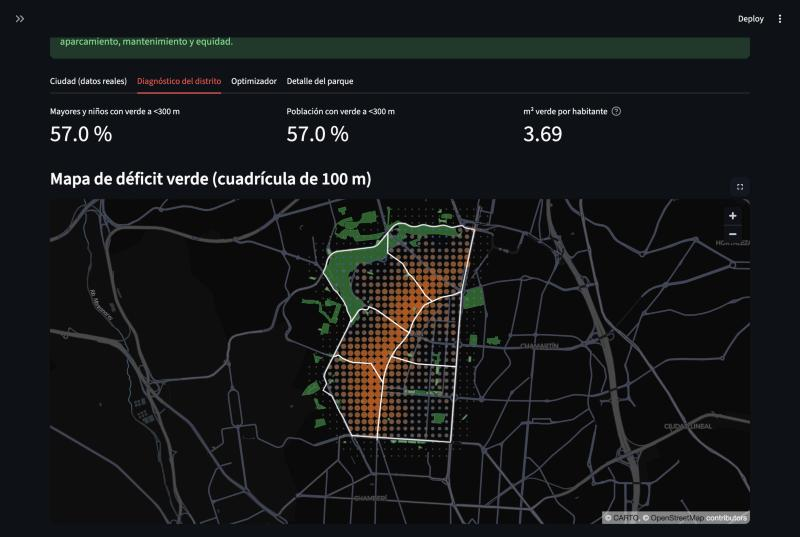
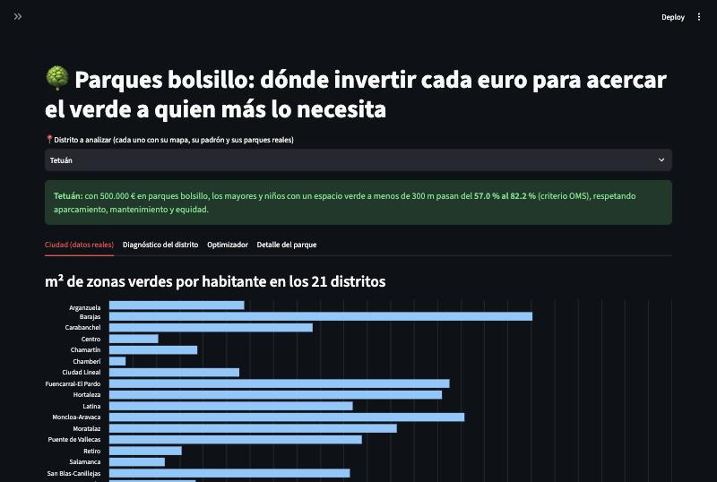
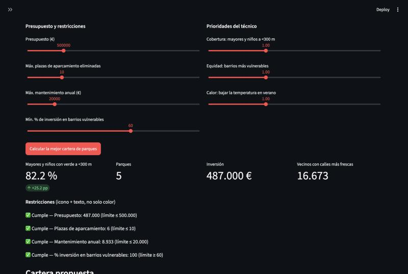
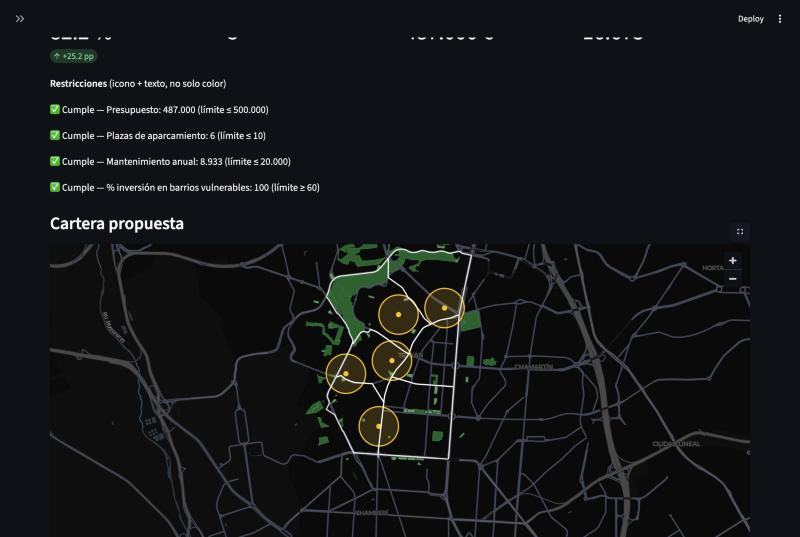
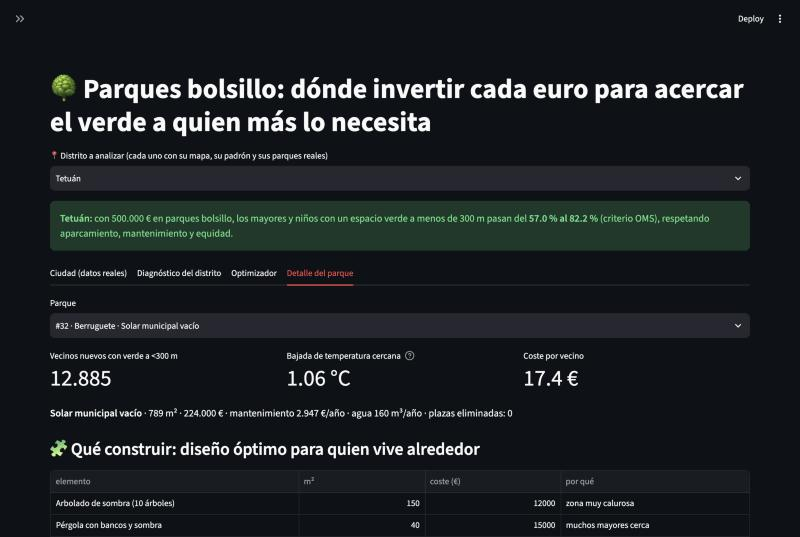
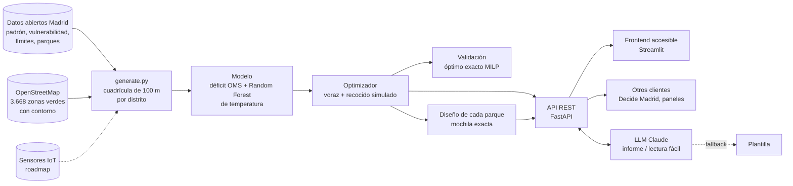

# 🌳 Parques bolsillo Madrid — dónde invertir cada euro para acercar el verde a quien más lo necesita

> Motor de decisión para técnicos municipales: **detecta** los barrios con déficit de zonas verdes, **decide dónde** poner
> cada parque bolsillo y **qué construir** en él, y lo **justifica** ante el pleno. Datos abiertos reales de Madrid,
> optimización validada frente al óptimo exacto e IA generativa.

- **Autor:** [villanuevadrian](https://github.com/villanuevadrian), en representación de la **Universidad Carlos III de Madrid (UC3M)**
- **Contexto:** prueba técnica de 2 horas del programa **Líderes Digitales Universitarios** (Cátedras Telefónica)
- **Reto #42 · Pilar Salud y Bienestar Urbano:** *«Diseña una app que detecte barrios con déficit de zonas verdes y proponga
  micro-intervenciones (parques bolsillo)»*



## Resultados clave
- **Tetuán, 500.000 €:** los mayores y niños con un espacio verde a menos de 300 m (criterio OMS) pasan del **57 % al 82 %**,
  cumpliendo los límites de aparcamiento, mantenimiento y equidad.
- **Validado:** la metaheurística alcanza el **98,8–100 % del óptimo exacto** (programación lineal entera) y es
  **2,7–9 veces mejor** que repartir parques al azar.
- **Escala:** funciona en los **21 distritos** y prioriza los **131 barrios** de Madrid con datos oficiales.

## Qué hace: tres decisiones encadenadas
| # | Decisión | Cómo |
|---|---|---|
| 1 | **Qué barrios** tienen déficit | Verde real por barrio (OpenStreetMap) + ranking oficial de vulnerabilidad; mapa por distrito con el criterio OMS (≥0,5 ha a 300 m) |
| 2 | **Dónde** poner cada parque bolsillo | Cobertura máxima con presupuesto y restricciones: voraz + recocido simulado, validado con el óptimo exacto (HiGHS) |
| 3 | **Qué construir** en cada uno | Mochila exacta sobre 8 micro-intervenciones (sombra, bancos, juegos, fuente, jardín de lluvia…) según quién vive alrededor |

Además: curva de escenarios de presupuesto (rendimientos decrecientes), **informe para el pleno** descargable (HTML
imprimible a PDF) y textos redactados por **IA generativa** (Claude) con respaldo por plantilla: el servicio nunca se cae.

| Ciudad: detección | Optimizador | Cartera propuesta | Qué construir |
|---|---|---|---|
|  |  |  |  |

- **Usuario:** técnico municipal (Junta de Distrito / Medio Ambiente). Los vecinos reciben la misma propuesta en lectura fácil.
- **Accesibilidad:** lectura fácil, texto grande, alto contraste, modo oscuro, ES/EN (beta), lectura en voz alta,
  descripción textual de mapas y gráficos y estados con icono **y** texto.
- **Negocio:** SaaS B2G para ayuntamientos; sensores IoT para medir el impacto real tras construir y recalibrar el modelo.

## Arquitectura

| Módulo | Qué hace |
|---|---|
| `data/generate.py` | Lee los datos oficiales (`data/raw/`) y OpenStreetMap; genera el ranking de barrios y la cuadrícula de cada distrito |
| `app/model.py` | Déficit, Random Forest de temperatura, optimizador, validación MILP y diseño de cada parque |
| `app/llm.py` | Informe para el pleno y lectura fácil con Claude; sin clave o con error → plantilla |
| `app/main.py` | API REST: `/ciudad`, `/barrios`, `/diagnostico`, `/optimizar`, `/escenarios`, `/validacion`, `/parque/{id}` |
| `frontend/streamlit_app.py` | Herramienta (Ciudad, Diagnóstico, Optimizador, Detalle) y sección «Sobre el proyecto» |

## Puesta en marcha
```bash
python3.12 -m venv .venv && source .venv/bin/activate
pip install -r requirements.lock.txt           # versiones exactas probadas
uvicorn app.main:app --reload                  # API -> http://localhost:8000/docs
streamlit run frontend/streamlit_app.py        # (otra terminal) app -> http://localhost:8501
```
Los datos procesados ya vienen en el repositorio; `python data/generate.py` los regenera desde `data/raw/`.
Opcional: copia `.env.example` a `.env` y añade tu `ANTHROPIC_API_KEY` para que los textos los redacte Claude.
Sin clave funciona igual (textos por plantilla).

## Datos y atribución
| Fuente | Uso | Licencia / atribución |
|---|---|---|
| [Ayuntamiento de Madrid — datos.madrid.es](https://datos.madrid.es): población por barrio (1-ene-2026), ranking de vulnerabilidad (2020), superficie verde por distrito (2025), principales parques y jardines, límites de barrios | Padrón, equidad, verde oficial, geometría | Reutilización con cita de la fuente: *Ayuntamiento de Madrid* |
| [OpenStreetMap](https://www.openstreetmap.org/copyright) (`leisure=park\|garden`, vía Overpass) | Contorno y superficie de 3.668 zonas verdes | © OpenStreetMap contributors, [ODbL](https://opendatacommons.org/licenses/odbl/) |
| Sintéticos calibrados | Reparto de población dentro de cada barrio, edades, temperatura, solares candidatos y costes | Generados en `data/generate.py` |

## Metodología y cálculos (cómo se obtiene cada número)
| Cálculo | Fórmula | Justificación / fuente |
|---|---|---|
| **Acceso a verde (KPI principal)** | % de mayores (≥65) y niños (<12) cuya celda está a ≤300 m en línea recta de un espacio verde de ≥0,5 ha | Indicador de la **OMS Europa** (*Urban green spaces: a brief for action*, 2017): verde de 0,5–1 ha a 300 m |
| **Distancia al verde** | distancia en línea recta del centro de la celda al **borde real** más cercano de una zona verde de ≥0,5 ha (borde muestreado cada 20 m; 0 si la celda está dentro) | Contornos de OpenStreetMap. Los 203 parques municipales sin contorno: centro + radio 150 m (parque) / 50 m (jardín) |
| **Verde por habitante** | m² de verde ÷ padrón | Distrito: dato oficial del Ayuntamiento. Barrio: suma de zonas OSM dentro del límite oficial del barrio |
| **Prioridad de barrio** | 0,6 × vulnerabilidad + 0,4 × déficit verde (1 − min(m²/hab, 15)/15) | Vulnerabilidad: ranking oficial del Ayuntamiento. 15 m²/hab: rango alto de las recomendaciones habituales (9–15). Pesos: hipótesis editable |
| **Índice de déficit de celda** | 0,45 × lejanía (dist/600 m) + 0,30 × calor (normalizado) + 0,25 × vulnerabilidad | Pondera la proximidad (criterio OMS) por encima del calor y la equidad. Pesos: hipótesis editable |
| **Bajada de temperatura** | Random Forest (verde, asfalto, densidad → °C) predice antes/después de añadir el parque en las celdas a ≤150 m | Modelo sustituto; error medio ±0,5 °C en validación. Datos de temperatura sintéticos → se recalibra con satélite |
| **Optimización** | max Σ pesos × (vulnerables nuevos a 300 m + equidad + personas refrescadas) sujeto a presupuesto ≤ B; las demás restricciones penalizan un 30 % cada una | Problema de cobertura máxima con presupuesto (NP-difícil): voraz por beneficio/coste + recocido simulado (1.500 iteraciones) |
| **Validación** | óptimo exacto por programación lineal entera (HiGHS): max Σ w·y, y_j ≤ Σ x_i que cubren j, Σ coste·x ≤ presupuesto | El recocido alcanza el 98,8–100 % del óptimo en los distritos probados; 2,7–9× mejor que carteras al azar |
| **Qué construir** | por parque, mochila exacta sobre 8 elementos (2⁸ = 256 combinaciones): max Σ utilidad sujeto a m² ≤ 85 % del solar y coste ≤ 35 % del presupuesto del parque; utilidad = Σ peso × beneficio (mayores, niños, calor, agua) | Pesos = proporción real de mayores y niños a <300 m e índice de calor de la zona; agua con peso fijo 0,3. Huella, coste y beneficio de cada elemento: hipótesis de orden de magnitud |
| **Coste por vecino** | coste del parque ÷ vecinos que ganan verde a 300 m | Costes de urbanización 150–320 €/m² y mantenimiento 3–6 €/m²·año: hipótesis de orden de magnitud |

## Limitaciones
- **Solares candidatos, costes y temperatura son sintéticos** (prueba de concepto). En producción: inventario de suelo
  municipal, catastro y temperatura satelital (Landsat/Sentinel).
- **OpenStreetMap es colaborativo**: puede faltar o sobrar alguna zona; se descartan jardines sin nombre (suelen ser patios privados).
- Los parques municipales no traen contorno (radio aproximado). **Distancias en línea recta**, no a pie.
- Ranking de vulnerabilidad de **2020** (último publicado). En distritos sin barrios vulnerables la restricción de equidad no aplica.
- Los textos de la IA pueden contener erratas: se indica su fuente y deben revisarse antes de presentarlos.

## Tests
```bash
python -m pytest -q          # 26 tests: API, auditoría de cálculos y validación frente al óptimo exacto (sin red)
./scripts/smoke.sh           # punta a punta: API real + Streamlit
```
Incluyen tests de **auditoría** que recalculan de forma independiente que cada celda cae en su barrio oficial, que la
población coincide con el padrón y que la cobertura del optimizador es correcta.

## Cómo se desarrolló
Construido en 2 horas con **Claude Code** como asistente de programación, con un flujo de ingeniería de software ligera:
1. **Plan antes de código** y aprobación de cada decisión (reto, usuario, métricas de éxito y de restricción).
2. **Pasos pequeños con tests** después de cada cambio (`pytest` + `scripts/smoke.sh`) y un commit por paso.
3. **Agente revisor independiente** (`.claude/agents/jurado.md`) que evalúa la app con la rúbrica del jurado sin haber
   visto el desarrollo; se aplicaron sus mejoras prioritarias.
4. **Auditoría de cálculos**: cada número se recalcula por separado y se valida el optimizador contra el óptimo exacto.

`CLAUDE.md` recoge las reglas de trabajo y `PROMPT_ARRANQUE.md` el prompt de preparación de la prueba.

## Licencia
Código bajo licencia [MIT](LICENSE). Los datos conservan su licencia original (ver *Datos y atribución*).
